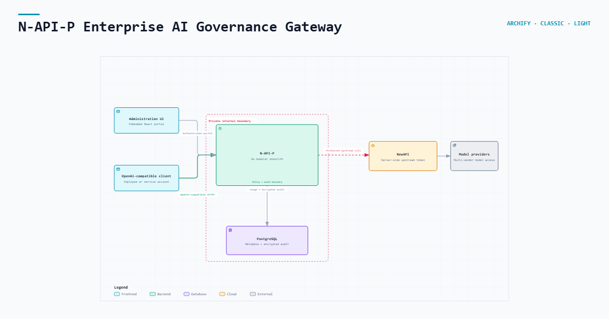

# N-API-P

**Enterprise AI Governance Gateway for NewAPI**

[English](README.md) | [简体中文](README.zh-CN.md) | [Documentation](https://nabr88887.github.io/N-API-P/)

[](https://github.com/Nabr88887/N-API-P/actions/workflows/ci.yml)
[](https://github.com/Nabr88887/N-API-P/releases)
[](LICENSE)
[](backend/go.mod)
[](frontend/package.json)
[](local-demo/docker-compose.yml)



N-API-P is a self-hosted governance layer between OpenAI-compatible clients
and [NewAPI](https://github.com/Calcium-Ion/new-api). It gives an organization
its own identity model, downstream API keys, model policy, usage attribution,
rate limits, encrypted audit records, and an embedded administration portal.
The NewAPI credential remains on the server and is never issued to employees.

> **Project status:** alpha / graduation design. N-API-P is suitable for
> learning, research, evaluation, and controlled internal pilots. It has not
> been independently assessed for production use.

## Why N-API-P?

NewAPI is a capable multi-model gateway, but an organization that gives
employees direct upstream access still has a governance gap: one upstream
credential can obscure who made each request, which internal policy applied,
which team should receive the cost, and what audit evidence remains after the
request completes.

N-API-P places those enterprise controls downstream of NewAPI:

| Concern | Direct NewAPI access | N-API-P |
| --- | --- | --- |
| Upstream credential | Shared with users or clients | Server-side only |
| Employee identity | Not modeled downstream | Invite-only local accounts |
| API credentials | Upstream tokens | Personal and service-account keys |
| Model policy | Upstream configuration | Permission-filtered model allowlist |
| Cost attribution | Aggregate upstream usage | Employee/team usage and price snapshots |
| Sensitive content | Depends on upstream logging | Encrypted, bounded-retention audit store |
| Audit failure | Request may already have run | Fail closed before upstream dispatch |

## At a Glance

- OpenAI-compatible `GET /v1/models` and `POST /v1/chat/completions`
- Non-streaming responses, SSE streaming, and tool-call payloads
- Invite-only local accounts and secure server-side sessions
- System administrator, team administrator, employee, and service-account roles
- Personal API keys and team-owned service-account keys
- Global model allowlist and request-level policy enforcement
- Token usage, immutable price snapshots, and cost attribution
- Application-encrypted request/response audit with bounded retention
- Administrator reauthentication and purpose-bound audit access
- Content-free JSON logs, Prometheus metrics, liveness, and readiness
- Go modular monolith with an embedded React/TypeScript administration UI
- Docker-first deployment with a self-contained synthetic local demo

## Architecture

```text
OpenAI-compatible client                 Administration UI
            |                                   |
            +---------------+-------------------+
                            |
                         N-API-P
                 identity / keys / policy /
                 limits / usage / audit
                       /           \
                      /             \
               PostgreSQL          NewAPI
          metadata + encrypted       |
          audit content             Model providers
```

The application does not store conversation state on behalf of clients.
Clients continue to send the complete conversation history with every
request, preserving OpenAI-compatible stateless behavior. N-API-P stores
control-plane metadata, usage facts, and encrypted audit content separately
from upstream model execution.

Open the [interactive architecture diagram](docs/assets/n-api-p-architecture.html)
for the full governance boundary and component map.

## Core Capabilities

### Identity and access

- Invite-only employee accounts; no public registration endpoint
- Password authentication with rate limits, temporary lockout, and server-side sessions
- System administrator, team administrator, employee, and service-account roles
- Password reauthentication before sensitive operations
- Administrator-assisted recovery with explicit key-revocation choices

### Keys and model policy

- Personal API keys for employees
- Group keys for named non-human service accounts
- One-time full-key display; only hashes and lifecycle metadata are persisted
- Per-owner and active-key limits
- Global model allowlist for the first release
- Internal policy resolver boundary for future team-level policies

### Gateway data plane

- OpenAI-compatible model listing and Chat Completions
- JSON request validation, tool-call support, and bounded payload sizes
- Non-streaming and SSE responses
- Global, employee, and service-account concurrency/rate controls
- Upstream credential isolated in a server-side secret file

### Usage and audit

- Input, output, and total token usage when reported by upstream
- Immutable price snapshot and request-level cost when usage is known
- Employee and team attribution
- Encrypted raw request/response audit with record-level expiry
- Application-level deletion after the retention deadline
- Raw-content access requires authorization, reauthentication, and a recorded reason
- New unaudited traffic fails closed when audit prerequisites are unavailable

### Operations

- Content-free structured logging
- Prometheus-format metrics under the internal metrics listener
- Liveness and readiness endpoints
- Docker health checks and a documented rollback boundary
- Metadata backups intentionally exclude raw audit content

## Synthetic Local Demo

The local demo uses generated credentials, a synthetic NewAPI-compatible mock,
and synthetic data. It does not contact a real NewAPI deployment.

### Prerequisites

- Docker Desktop with Docker Compose
- PowerShell 7+
- OpenSSL available on `PATH`

### Start

```powershell
git clone https://github.com/Nabr88887/N-API-P.git
Set-Location .\N-API-P
.\local-demo\start.ps1
```

The demo starts at:

```text
https://localhost:8443
```

Generated synthetic credentials are written to:

```text
local-demo/.runtime/credentials/demo-credentials.txt
```

### Stop

```powershell
.\local-demo\stop.ps1
```

The runtime directory is intentionally ignored by Git.

## Local Development

### Backend

Requirements: Go 1.25+

```powershell
Set-Location .\backend
go test ./...
go vet ./...
go build -o ..\n-api-p.exe .\cmd\n-api-p
```

### Frontend

Requirements: Node.js 24+ and npm

```powershell
Set-Location .\frontend
npm ci --ignore-scripts
npm run verify
```

`npm run verify` runs component/unit tests, ESLint, TypeScript compilation, and
the production Vite build.

## Configuration

Configuration examples live under `deploy/`:

- `deploy/n-api-p.env.example`
- `deploy/nginx/n-api-p.conf.example`

All placeholder values prefixed with `REPLACE_` must be replaced in an
operator-owned file outside Git.

Never commit:

- NewAPI tokens or API keys
- Portal passwords or session secrets
- Database credentials or rendered environment files
- Audit encryption keys or recovery material
- Real prompts, responses, employee records, or database dumps

See [Security](SECURITY.md) before exposing the service outside an isolated
test environment.

## Repository Layout

```text
backend/       Go service, gateway, authentication, audit, and migrations
frontend/      React, TypeScript, Vite, and the administration UI
deploy/        Environment and reverse-proxy examples
docs/          Operations guides, architecture assets, and GitHub Pages
local-demo/    Synthetic Docker demo with a generated NewAPI-compatible mock
```

## Documentation

- [Project documentation](https://nabr88887.github.io/N-API-P/)
- [Operations guide](docs/OPERATIONS.zh-CN.md)
- [Interactive architecture](docs/assets/n-api-p-architecture.html)
- [Changelog](CHANGELOG.md)
- [Contributing](CONTRIBUTING.md)
- [Security policy](SECURITY.md)

## Project Origin

N-API-P began as a graduation design project at the University of South China.
The repository is published to support learning, reproducibility, and further
review. See [CITATION.cff](CITATION.cff) for citation metadata.

## Roadmap

- Stabilize the first tagged release and deployment examples
- Expand synthetic integration coverage around streaming and audit recovery
- Add operator-focused troubleshooting and API examples
- Evaluate team-level model policies without changing issued client keys
- Improve browser E2E coverage in a controlled test environment

## Contributing

Issues and focused pull requests are welcome. Read
[CONTRIBUTING.md](CONTRIBUTING.md) before submitting changes. Security reports
must follow [SECURITY.md](SECURITY.md) and must not include secrets in public
issues.

## License

Released under the [MIT License](LICENSE).
