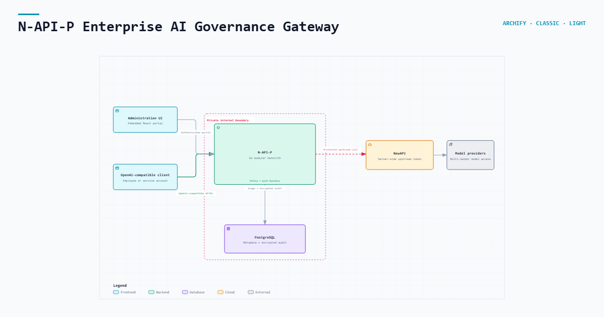

# N-API-P

**基于 NewAPI 的企业内部 AI 治理网关**

[English](README.md) | [简体中文](README.zh-CN.md) | [在线文档](https://nabr88887.github.io/N-API-P/)

[](https://github.com/Nabr88887/N-API-P/actions/workflows/ci.yml)
[](https://github.com/Nabr88887/N-API-P/releases)
[](LICENSE)
[](backend/go.mod)
[](frontend/package.json)
[](local-demo/docker-compose.yml)



N-API-P 是部署在 OpenAI 兼容客户端与
[NewAPI](https://github.com/Calcium-Ion/new-api) 之间的自托管治理层。
它为企业提供独立身份、下游密钥、模型策略、用量归属、限流、加密审计和
内嵌管理界面。NewAPI 上游凭据只保存在服务端，不会下发给员工。

> **项目状态：** alpha / 毕业设计。适用于学习、研究、评估和受控内部试点，
> 尚未经过独立的生产环境适用性评估。

## 为什么需要 N-API-P

NewAPI 能够完成多模型聚合和统一计费，但当员工直接使用上游访问能力时，
企业仍然难以回答：这次请求是谁发起的、命中了什么内部策略、费用应归属哪个团队，
以及请求结束后还留下了哪些可验证的审计证据。

N-API-P 把这些治理能力放在 NewAPI 下游：

| 治理问题 | 直接使用 NewAPI | N-API-P |
| --- | --- | --- |
| 上游凭据 | 可能被用户或客户端持有 | 仅保存在服务端 |
| 员工身份 | 下游未建模 | 邀请制本地账号 |
| API 凭据 | 直接使用上游令牌 | 个人密钥和服务账号密钥 |
| 模型策略 | 依赖上游配置 | 按身份过滤的模型 allowlist |
| 成本归属 | 上游汇总为主 | 员工/团队 usage 与价格快照 |
| 敏感内容 | 取决于上游日志 | 加密、可删除的审计存储 |
| 审计失败 | 请求可能已经发出 | 上游调用前 fail closed |

## 核心能力

- 兼容 OpenAI 的 `GET /v1/models` 和 `POST /v1/chat/completions`
- 非流式响应、SSE 流式响应和工具调用
- 邀请制本地账号和服务端会话
- 系统管理员、团队管理员、员工和服务账号角色
- 员工 Personal API Key 与团队服务账号 Group Key
- 全局模型 allowlist 和请求级策略校验
- token 用量、不可变价格快照和成本归属
- 应用层加密的请求/响应审计和有界保留期
- 管理员敏感操作重认证与带原因的审计查看
- content-free 日志、Prometheus 指标、liveness 和 readiness
- Go 模块化单体与内嵌 React/TypeScript 管理界面
- Docker 部署示例与使用合成数据的完整本地演示

## 系统架构

```text
OpenAI 兼容客户端                       管理界面
        |                                  |
        +----------------+-----------------+
                         |
                      N-API-P
              身份 / 密钥 / 策略 / 限流 /
                 用量 / 审计 / 可观测性
                    /             \
                   /               \
              PostgreSQL           NewAPI
           元数据 + 加密审计           |
                                    模型供应商
```

应用不保存对话状态，客户端每次请求仍需发送完整历史。N-API-P 将控制面元数据、
用量事实和加密审计内容与上游模型执行分开管理。

完整组件关系请查看
[交互式架构图](docs/assets/n-api-p-architecture.html)。

## 合成本地演示

本地演示使用生成的凭据、合成数据和本地 NewAPI 兼容 mock，不连接真实 NewAPI。

### 环境要求

- Docker Desktop 与 Docker Compose
- PowerShell 7+
- `PATH` 中可用的 OpenSSL

### 启动

```powershell
git clone https://github.com/Nabr88887/N-API-P.git
Set-Location .\N-API-P
.\local-demo\start.ps1
```

访问地址：

```text
https://localhost:8443
```

合成凭据生成在：

```text
local-demo/.runtime/credentials/demo-credentials.txt
```

### 停止

```powershell
.\local-demo\stop.ps1
```

`local-demo/.runtime/` 已被 Git 忽略。

## 本地开发

### 后端

需要 Go 1.25+：

```powershell
Set-Location .\backend
go test ./...
go vet ./...
go build -o ..\n-api-p.exe .\cmd\n-api-p
```

### 前端

需要 Node.js 24+ 和 npm：

```powershell
Set-Location .\frontend
npm ci --ignore-scripts
npm run verify
```

`npm run verify` 会运行组件/单元测试、ESLint、TypeScript 编译和生产 Vite 构建。

## 配置与安全

配置示例位于：

- `deploy/n-api-p.env.example`
- `deploy/nginx/n-api-p.conf.example`

所有以 `REPLACE_` 开头的占位值都应替换为运维人员管理的非仓库文件。

禁止提交：

- NewAPI token 或 API Key
- 门户密码或会话密钥
- 数据库凭据或渲染后的环境文件
- 审计加密密钥或恢复材料
- 真实提示词、响应、员工记录或数据库转储

在隔离测试环境之外暴露服务前，请先阅读 [Security](SECURITY.md)。

## 仓库目录

```text
backend/       Go 服务、网关、认证、审计和数据库迁移
frontend/      React、TypeScript、Vite 管理界面
deploy/        环境与反向代理配置示例
docs/          运维手册、架构资产和 GitHub Pages
local-demo/    使用合成数据和 mock NewAPI 的 Docker 演示
```

## 文档

- [在线项目文档](https://nabr88887.github.io/N-API-P/)
- [中文操作手册](docs/OPERATIONS.zh-CN.md)
- [交互式架构图](docs/assets/n-api-p-architecture.html)
- [变更记录](CHANGELOG.md)
- [贡献指南](CONTRIBUTING.md)
- [安全策略](SECURITY.md)

## 项目来源

N-API-P 起源于南华大学软件工程毕业设计。仓库用于学习、复现和进一步评审，
引用信息见 [CITATION.cff](CITATION.cff)。

## 后续计划

- 稳定首个版本标签和部署示例
- 扩展流式响应与审计恢复的合成集成测试
- 补充面向运维人员的故障排查和 API 示例
- 在不更换已签发客户端密钥的前提下评估团队级模型策略
- 在受控测试环境中完善浏览器 E2E 覆盖

## 贡献

欢迎提交范围明确的 Issue 和 Pull Request。提交前请阅读
[CONTRIBUTING.md](CONTRIBUTING.md)。安全问题必须遵循
[SECURITY.md](SECURITY.md)，不要在公开 Issue 中披露敏感信息。

## 许可证

本项目采用 [MIT License](LICENSE)。
